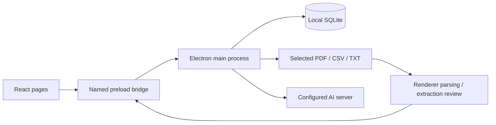

> Historical analysis of the original implementation. The replacement pages and current behavior are documented in README.md and IMPLEMENTATION.md.

> Historical analysis: this document describes the original codebase before the upgrade. Current behavior and accepted design are documented in README.md, FEATURE-DESIGN.md and IMPLEMENTATION.md.

# OpenAnchor — folder and design assessment

Reviewed 3 October 2026. This assessment covers the current working folder, including modified and untracked source files, rather than only the last Git commit.

Follow-up product requirements and the researched TabPFN-3 integration proposal are recorded in [FEATURE-DESIGN.md](FEATURE-DESIGN.md). This supersedes the initial priority of forecasting as a distant future feature: forecasting and budget planning now form part of the proposed next product direction, after accounting and categorization fixes.

## Assessment

OpenAnchor is a local desktop personal-finance application. It imports bank statements, maintains a transaction ledger, presents spending analytics, tracks monthly category budgets, detects repeating charges, and gives AI explanations through a configurable Ollama or OpenAI-compatible server.

The product direction is strong: local ownership of financial data, useful functionality without AI, and AI as an optional interpretation layer. The implementation is a substantial prototype with several confirmed financial-correctness defects. Improve the reliability of importing and accounting before expanding the feature surface.

The folder contains roughly 5,663 lines across the Electron backend, React application, utilities, and main stylesheet. Installed dependencies occupy about 591 MB; the authored `src` and `electron` folders together occupy about 300 KB. Dependency size should not be confused with application complexity or the size of a final installer.

## What it currently does

| Area | Implemented behavior | Important limit |
|---|---|---|
| Dashboard | Stored account balances, income, expenses, net flow, savings rate, cash-flow and category charts, generated health report | Balance is a dated snapshot; it does not automatically advance when transactions change |
| Transactions | Add/edit/delete, bulk delete/category assignment, search, sort, account/type/category/date filters | Account reassignment is shown in the editor but ignored by the database update |
| Merchants | Transaction subtab; totals, averages, counts, date span, and history | Groups by lowercase trimmed description, rather than a stable merchant identity |
| Import | PDF/TXT text extraction followed by per-page AI extraction; direct German CSV parsing; editable review; optional balance update | No scanned-PDF OCR, duplicate prevention, reconciliation, or saved import batches |
| Categorization | Keywords, similar categorized history, then AI batches of 16 | Applied in the CSV flow; PDF/TXT extraction currently leaves categories empty |
| Accounts | Default account migration, multiple accounts, currencies, manual/statement balances, account deletion safeguards | No transfer relationship, exchange-rate conversion, account editing UI, or balance history |
| Budget | Per-account category limits, optional overall monthly allocation cap, spending progress, AI comments | Current month only; no rollover/history; cap refresh has a stale-state issue |
| Habits | Description similarity plus interval consistency to infer repeating expenses; weekday and monthly spending charts; AI report | Heuristic suggestions, not confirmed subscriptions; all-account analysis can mix currencies |
| AI assistant | Streaming replies, stop control, persistent chats, titles, message editing, configurable data window and account scope | Detailed prompt includes only the latest 20 transactions; saved chats do not retain account scope |
| Settings | Providers, model selections, endpoint URLs, currencies, categories, accounts, themes, name, personal notes | No integrated backup, restore, transaction export, or data-management controls |

The app does not connect to a bank, fetch live balances, initiate payments, trade investments, or autonomously modify finances through AI tools. AI receives text and returns text; imported results become records only after user review.

Defaults point AI requests to loopback servers. The implementation has no apparent application telemetry, but its absolute privacy claims are inaccurate: the HTML requests Google Fonts, and provider URLs can point at a remote server. Financial data sent to an AI provider follows the configured endpoint, not an enforced local-only policy.

## Structure and data flow

```text
OpenAnchor/
  electron/
    main.js          Desktop lifecycle, IPC handlers, file reading, AI HTTP transport
    preload.js       Named window.api bridge between the UI and backend
    database.js      SQLite schema, migrations, CRUD, aggregate queries
  src/
    main.jsx         React entry point
    App.jsx          Top navigation, shared settings/accounts/categories, AI status
    components/      Seven pages, merchant subtab, account switcher, toast
    utils/           CSV parsing, categorization, recurring detection, themes,
                     currency, dates, greetings, account helpers
    index.css        Semantic theme variables and global styling
  assets/            README screenshots; not the current UI implementation
  package.json       Development, build, packaging, native SQLite rebuild
  vite.config.js     Renderer development server and production compilation
  tailwind.config.js Styling tokens and animation configuration
  README.md          Installation and product documentation, partly outdated
  node_modules/      Installed third-party dependencies
```



SQLite has seven domain tables: `accounts`, `transactions`, `categories`, `settings`, `budgets`, `chats`, and `chat_messages`. Transactions reference accounts but store categories as names. Budgets are unique per account/category. Chat messages cascade on chat deletion, and budgets cascade on account deletion. Existing single-account records are migrated to a default account.

Financial totals are calculated in SQL. Parsing, categorization orchestration, recurring-charge detection, prompt composition, and most request state live inside React pages. Navigation mounts one page at a time, so returning to a page resets its local state and can restart work. There is no central transaction cache or invalidation mechanism.

## What is good about the design

1. **Appropriate desktop architecture.** Electron, React, and SQLite suit a personal application that should keep working without a cloud account. There is no unnecessary service infrastructure.
2. **A meaningful process boundary.** The renderer has Node integration disabled and context isolation enabled. The preload exposes named methods instead of a raw IPC transport.
3. **Mostly sound database mechanics.** Queries bind values, bulk writes run in transactions, foreign keys are enabled, and WAL is configured. The account migration explicitly preserves older records.
4. **AI is optional for much of the product.** Manual transactions, CSV parsing, charts, budgets, and recurring heuristics do not require inference. Categorization tries inexpensive rules and history before using a model.
5. **User review before persistence.** Import review permits corrections and selection. The backend rejects deletion of accounts that still contain transactions, and imported balances only replace older snapshots.
6. **A coherent visual foundation.** Warm surfaces, serif display headings, monospaced amounts, and reusable semantic CSS variables establish a recognizable identity. Themes share the same visual system.
7. **Good feature boundaries for the current size.** Pages and utility files are easy to locate. Keeping this a single application is reasonable; a large framework or microservice rewrite would add unnecessary cost.

## Confirmed defects and design weaknesses

### Fix first: amounts, dates, balances, and account identity

| Finding | Evidence and consequence | Recommended change |
|---|---|---|
| Decimal parsing can inflate money by 100× | PDF normalization turns string `"42.50"` into `4250`. CSV `-12.34` becomes an expense of `1234` | Parse according to an explicit source locale; validate numeric JSON rather than guessing |
| Unsupported CSV dates silently become today | An ISO-date CSV row dated `2025-01-15` becomes the execution day's date. `31.02.2026` is accepted as `2026-02-31` | Reject unsupported/invalid dates with row-level errors; never substitute today for historical data |
| Negative balances become positive | Both CSV closing balances and PDF normalization apply absolute value; `-123.45` becomes `123.45` | Preserve signed balances; use transaction direction only for transaction normalization |
| Zero balances can be skipped | Balance detection and saving use truthiness tests | Distinguish zero from missing data explicitly |
| Account editing does not persist | The modal submits `account_id`, but `updateTransaction` omits it from SQL | Validate and persist the new account; add an integration regression check |
| Duplicate imports are accepted | Re-inserting an identical transaction creates another record | Track import batches/file hashes and review overlapping transactions; allow legitimate identical purchases |
| Transfers inflate income and spending | Moving 100 between two accounts adds 100 to income and 100 to expenses, even with category `Transfers` | Introduce explicit linked transfers and exclude them from household income/spending metrics |
| Mixed currencies are still summed | Dashboard/transactions warn but show combined figures; Habits and Merchants also aggregate without currency separation | Group totals by currency or require a compatible account scope; a warning cannot make the total valid |
| Financial input validation is insufficient | Database probes accepted an impossible date, a null account, and negative income | Validate at the privileged boundary and enforce database constraints after migrating existing data |
| Deficits lose their sign in AI prompts | Income 100 and expenses 150 produces prompt text `Net Balance: €50.00` | Separate signed money formatting from absolute charge formatting |

Relevant implementations: [CSV parser](electron/imports.js), [import normalization](src/components/ReliableImport.jsx), [transaction updates](electron/database.js), [AI context](src/components/EvidenceAssistant.jsx), and [summary calculations](electron/database.js).

Store money as integer minor units with explicit currency precision, rather than SQLite `REAL` and scattered JavaScript floating-point arithmetic. SQLite documents that floating-point values are approximate. The existing formatters also always display two decimal places despite supporting JPY. [SQLite floating-point documentation](https://www.sqlite.org/floatingpoint.html).

### Import reliability

- PDF text reconstruction concatenates adjacent text items without explicit spaces and loses debit/credit column geometry. The AI is asked to infer structure that the parser has already discarded.
- The balance-specific prompt uses only the first 3,000 characters. A closing balance near the end of a statement can be missed. A fallback assigns today's date to an uncertain balance, potentially allowing an old statement to overwrite a newer snapshot.
- A failed PDF page is logged and skipped while other pages continue. Review does not clearly identify incomplete extraction.
- PDF/TXT transactions do not pass through the shared categorizer. This contradicts the advertised hybrid import behavior.
- Import inserts transactions and updates the balance in separate calls. A failure between them leaves partial results. The success screen claims a balance was updated without checking whether the backend accepted it as newer.
- Filename, import identity, statement period, extraction errors, and source-page provenance are not persisted with transactions; `source` is only `upload`.
- The handwritten CSV parser does not support quoted multiline descriptions. A valid synthetic multiline row was silently lost.
- Keyword rules run before learned history. A user's previous correction of REWE to a custom category loses to the built-in grocery rule. AI category names are accepted without checking that they exist or suit the transaction type.

Use a shared, validated import pipeline: parse → normalize → categorize → detect overlap → reconcile → review → commit one import batch. Keep explicit user rules ahead of built-in suggestions. Reuse the installed CSV parsing library after confirming its renderer/worker integration instead of maintaining a partial CSV implementation.

### State, budgets, analytics, and AI behavior

- Saving a budget cap updates SQLite but does not refresh shared account state. The displayed cap and allocation calculation can stay stale until accounts reload.
- Dashboard, habits, and budget AI reports are not invalidated when their relevant account/data changes. Account-scoped budget analyses are stored only by category, so an explanation can carry into another account.
- Chat editing truncates only the visible history. Old messages remain in SQLite and return after reopening the chat. Replies are persisted using a mutable active-chat reference, so switching chats during generation risks misattribution.
- Chats save the date-window label but not the account, exact date bounds, data revision, or context snapshot. Reopening one mixes old discussion with newly generated context.
- The assistant advertises the total transaction count, but its prompt includes only the latest 20 detailed transactions. Category summaries cover the window; arbitrary transaction-level questions do not.
- The health report divides whatever history exists in the past year by 12. A user who imports one month gets an artificially low baseline and exaggerated spending spikes.
- Recurrence groups are not scoped by account/currency in all-account mode and do not check amount consistency or whether charges are still active. Three daily grocery visits were labeled `Weekly`, with an overdue predicted date presented without qualification.
- Merchants use a different identity rule from recurring detection. Variable bank reference numbers fragment a real merchant into several entries.
- Categories use unconstrained name strings. Deleting a category leaves transactions and budgets referencing its old name; a synthetic database probe confirmed this.
- Shared date helpers use UTC for today while budget month boundaries use local time. This can disagree around midnight. Missing periods are absent from charts instead of being represented as zero/data unavailable.

Create shared account/date/currency scope, a transaction revision or cache-invalidation mechanism, stable category and merchant identities, and immutable context per AI request. AI should explain deterministic calculations and link to the transactions that support a claim.

### AI transport and desktop boundaries

The HTTP helper has no timeout, does not reject error HTTP statuses, and drops URL path prefixes. A mocked HTTP 500 response was reported as connected; generation returned an empty answer. The SSE parser emitted no tokens for CRLF-delimited events. Streaming has one global request slot, no request IDs, and no explicit handling of response aborts or incomplete buffers.

Add provider adapters with URL validation, preserved base paths, status/error checks, bounded requests, robust UTF-8/event parsing, request IDs, and explicit cancellation that settles the pending operation. Do not silently hide backend errors as empty answers or an empty model list.

Renderer sandboxing is explicitly disabled. IPC does not validate sender identity or input schemas, file extraction accepts an arbitrary renderer-supplied path, and no navigation/window-creation restrictions are defined. The CSP permits inline/eval scripts and remote font resources. These are gaps in defense, not evidence of an observed exploit. Enable sandboxing, narrow the production CSP, validate IPC callers and payloads, and tie file reads to authorized selections. [Electron security guidance](https://www.electronjs.org/docs/latest/tutorial/security).

The SQLite database is not encrypted by this implementation. Local storage provides ownership but does not by itself provide at-rest protection. Add a documented backup/restore workflow before optional encryption. Because WAL is enabled, copying only a live database file is not a reliable backup procedure; use a supported consistent snapshot mechanism. [SQLite backup documentation](https://www.sqlite.org/backup.html).

### Maintainability and distribution

- Large page files combine rendering, data fetching, business rules, prompts, and orchestration. Extract shared domain rules and hooks as changes justify it; do not mechanically split every JSX block.
- There are no project tests, test script, lint/type checks, or CI configuration in the folder. A successful renderer build does not verify financial behavior.
- The frontend eagerly imports every page and Recharts. The production JavaScript bundle is about 690 KB before gzip, and Vite flags its size. Lazy-load pages if startup measurements justify it.
- Transaction searches fetch on each keystroke; transaction tables have no pagination/virtualization. Similarity matching can become expensive with growing history. Add account/date indexes and measure on a representative large ledger before broader optimization.
- Two bulk-category IPC methods implement essentially the same action. Dead variables/imports and old theme naming also remain.
- `package-lock.json` exists locally but is ignored and absent from tracked files. Build output folders are not ignored. Make dependency resolution reproducible and ignore generated artifacts.
- Configuration mixes CommonJS backend files and ESM-style build configuration without explicit module boundaries; the current build emits warnings.
- Packaging targets macOS and Windows, but no Linux target or signing/release/update workflow is defined. Installer packaging was not verified in this review.
- README screenshots/features describe an earlier UI and list budgets/multiple accounts as future work even though they are present now. Privacy and assistant-context claims also need correction.

## Product and visual design recommendations

Keep the warm visual identity, but make trustworthy figures and clear actions its focus.

1. **One consistent scope control.** Preserve selected account and date range across analytics pages. Show currency and data coverage beside totals. Budget should offer account choices without an `All accounts` option that does nothing.
2. **An actionable overview.** Put dated balances, signed net cash flow, budget remaining, upcoming confirmed bills, and import freshness first. Let charts and prose reports follow.
3. **Clear import review.** Show row errors, failed pages, duplicates, source currency/account, and balance reconciliation. Separate confirmed fields from inferred ones. Retain import history and make batch undo possible.
4. **Better settings hierarchy.** Group Data & Backup, Accounts, AI, Appearance, and Profile. The current Save button appears before later profile fields; users should see an obvious save state wherever editable settings appear.
5. **Accessible controls.** Several actions appear only on hover, clickable rows/dropzones are non-button elements, and text selection is disabled globally. Add keyboard activation, visible focus, dialog focus handling, labels, status announcements, and selectable statements/chat output. Accent text tokens are defined but not used by many buttons; computed light caramel button contrast was about 3.43:1 and muted card text about 4.06:1. Review contrast in the actual rendered app.
6. **Reduce repeated charts.** Category bars and a top-eight-only donut largely repeat one another; the donut omits remaining categories without an Other slice. Keep one main breakdown and an optional compact distribution view with an explicit remainder.

This is a source-level UI assessment. The stored screenshots represent an earlier interface; a live visual/keyboard audit of the current Electron window remains worthwhile.

## What to add, simplify, or defer

| Priority | Add or change | User benefit |
|---|---|---|
| First | Strict money/date validation, signed balances, explicit transfers, currency-safe totals, account-update fix | Numbers that can be trusted |
| First | Import batches, overlap review, reconciliation, provenance, batch undo | Safe repeat imports and recoverable mistakes |
| First | Built-in consistent backup/restore and CSV export | Ownership includes recovery and portability |
| Next | Correctable merchant aliases and persistent user categorization rules | Less repetitive cleanup |
| Next | Confirm/dismiss recurring charges, upcoming-bill calendar, stale-subscription handling | A useful next-month view instead of uncertain patterns |
| Next | Budget editing, prior-month view, deterministic spending pace, optional rollover | Practical planning beyond the current month |
| Next | Evidence-linked assistant answers and persistent chat scope | Explainable, repeatable AI assistance |
| Later | Savings goals, balance/net-worth history, cash-flow forecast | Forward planning after the ledger is reliable |
| Later | Bank-format profiles and OCR/vision for scanned statements | Wider import coverage after import validation is solid |

Simplify duplicated category APIs, repeated formatting/date/filter code, repeated AI provider warnings, and redundant charts. Keep separate extraction/assistant models and the offline core. Make automatic health-report generation optional or cache it by data revision so navigation does not repeatedly use local compute.

Defer bank sync, cloud accounts, investment trading, autonomous financial actions, and a large plugin/framework layer. Each expands the product's complexity before the current accounting foundation is reliable. Optional encrypted backups are a more focused privacy addition than introducing cloud synchronization first.

## Suggested technical evolution

Keep the existing stack. Gradually move toward:

```text
electron/
  ipc/                 Sender validation and input contracts
  services/            Imports, backups, AI providers/request lifecycle
  db/                  Versioned migrations and focused repositories
src/
  features/            Dashboard, transactions, imports, budget, habits, assistant
  shared/              Controls, hooks, account/date scope, formatting
shared/
  domain/              Money, dates, categories, transfers, import validation
  contracts/           Typed request/result shapes
```

Begin with money/date validation and a single import commit API. Add versioned migrations and tests around those operations. Move long-running parsing/inference orchestration out of page lifecycles, with progress and cancellation owned by jobs. Introduce stronger types incrementally where they protect cross-process contracts.

## Verification and limits

- Inspected all authored source modules, app/build configuration, README, Git status/history, and asset/dependency inventory. Third-party dependency internals were not audited wholesale.
- Production renderer build passed using the existing dependencies. It reported bundle-size and module-format warnings. Desktop installer creation was not run.
- Exercised the actual database implementation under Electron's Node runtime against a fresh synthetic database in `/private/tmp`; the user's finance database was not opened or changed.
- Exercised actual CSV, normalization, categorization, and recurring utility functions with synthetic cases. Confirmed amount/date/sign problems, ignored account edits, duplicate insertion, transfer totals, dangling categories, invalid database inputs, and keyword priority over user history.
- Exercised AI transport using mocked HTTP responses, without contacting an AI provider. Confirmed HTTP error misclassification, URL path removal, and CRLF SSE parsing failure. Real models, statement files, and stop-generation behavior were not tested end to end.
- App source was not modified. This report is the review deliverable.
