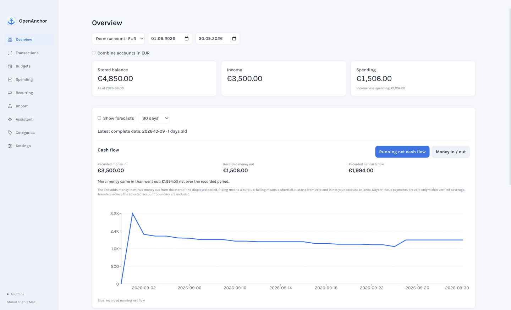
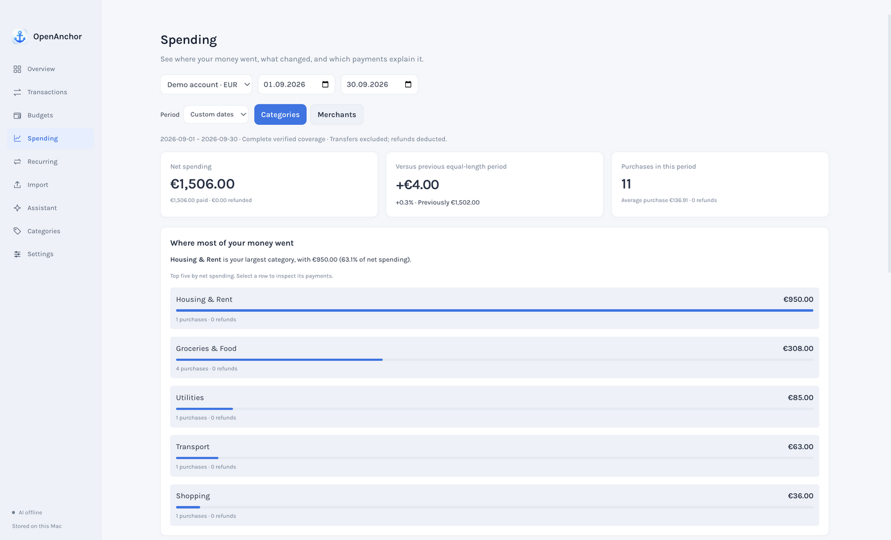
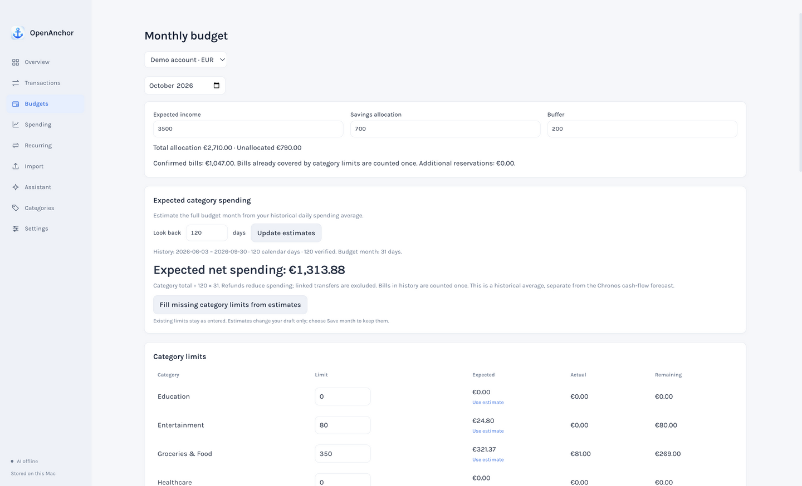

# OpenAnchor

A desktop app to understand your money and plan ahead. Your records stay on your computer. Built for Macs with Apple Silicon (M1 or newer).

## What you can do

- **Import statements:** CSV, PDF and TXT. Review transactions and AI category suggestions before saving. Check for duplicates, missing periods and balance differences.
- **Understand spending:** compare categories and merchants over a date range, then open the payments behind each total.
- **Plan your month:** set category limits, savings and a buffer. Estimate spending from the last 120 days, or choose another window. See bills and income on a calendar, with budget alerts.
- **Track regular payments:** confirm subscriptions, bills and recurring income. Add schedules manually when needed.
- **Look ahead:** optional local Chronos-2 cash-flow forecasts for 30, 90 or 180 days. By default, forecasts need 180 days of confirmed complete statements.
- **Get help:** a financial health summary and an optional AI assistant using Ollama or llama.cpp. Add your own categories and keywords.

## A look inside

All names, transactions and amounts below are made up.

**Overview — income, spending and cash flow.**



**Spending — see where your money goes.**



**Budgets — plan limits and estimate monthly spending.**



## Get started

There is no ready-to-download installer yet. To run the app from this folder:

1. Install [Node.js](https://nodejs.org/en/download), version 22.12 or newer.
2. Open **Terminal**. Type `cd ` (including the space), drag the OpenAnchor folder into the window, then press Return.
3. Run these two commands, one at a time:

   ```sh
   npm install
   npm run dev
   ```

In the app, create or choose an account, open **Import**, and review your statement before saving it. Confirm its complete date range so reports can distinguish missing records from days with no spending.

CSV imports, budgets and spending reports work without AI. For PDF/TXT extraction or AI explanations, connect Ollama or llama.cpp in **Settings**. Forecasting has its own setup in Settings and downloads its model once.

## Privacy and backups

No bank login, cloud account or built-in tracking is needed. Use a local AI connection to keep AI processing on your computer; a remote connection sends selected data to that server.

Use **Settings → Data management** to back up, restore or export records. **Wipe data** resets the app but keeps recovery backups and downloaded models. Keep backups private.

Scanned PDFs and automatic bank syncing are not supported yet. Forecasts are estimates, not guarantees.

<details>
<summary>For contributors</summary>

Run checks with `npm test`. Build a local Mac app with `npm run build:mac:dir`; find it in `dist-electron/mac-arm64/`. Nothing is published by these commands.

See [implementation notes](IMPLEMENTATION.md) for technical details. Regenerate the demo screenshots with `node scripts/readme-screenshots.cjs` after building the app; this uses a separate profile with fictional records.

</details>

[MIT license](LICENSE)
